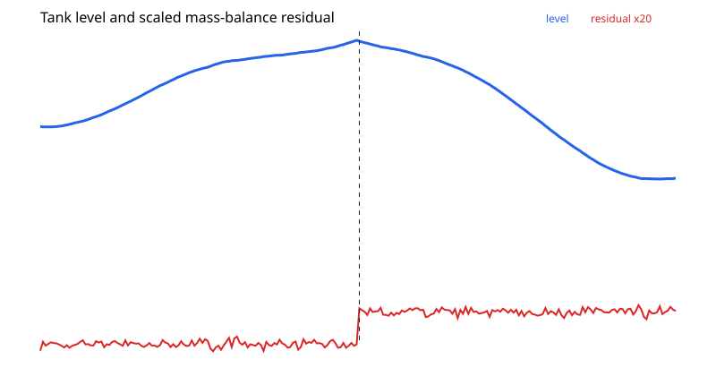
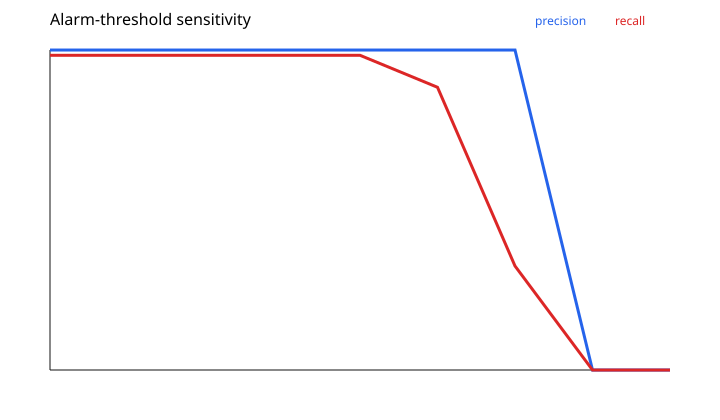

# Results and interpretation

At the primary threshold 0.22, the detector achieves **1.000 precision**, **0.9833 recall**, and first alarms at step 122, two steps after leak onset.

The threshold sweep shows stable behavior from 0.10 through 0.30: precision remains 1.000, recall remains 0.9833, and delay remains two steps. Recall falls to 0.8833 at threshold 0.35 and 0.325 at 0.40. Thresholds 0.45 and 0.50 miss the leak entirely.

The absence of false alarms in this controlled simulation supports the persistence rule for the chosen noise level. It does not establish a field false-alarm rate. That requires long-duration leak-free data and realistic disturbances.

Exact step-level values are in `simulation.csv`; exact sensitivity values are in `threshold_sweep.csv`.
